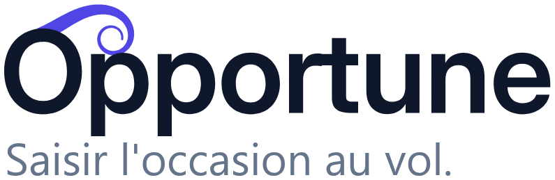
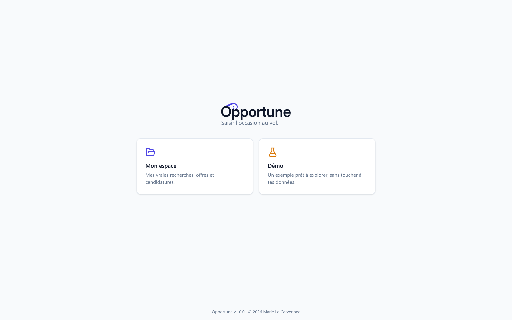
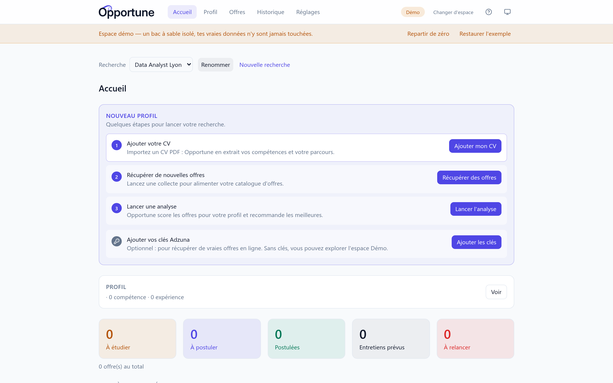
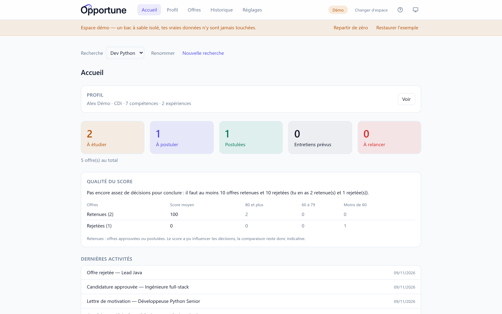
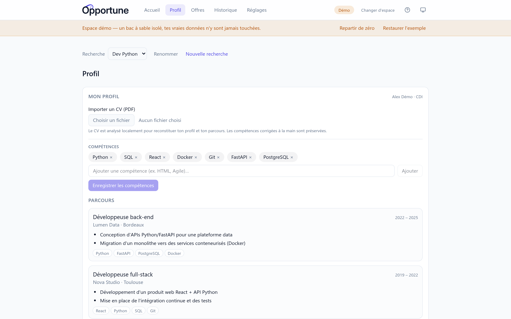
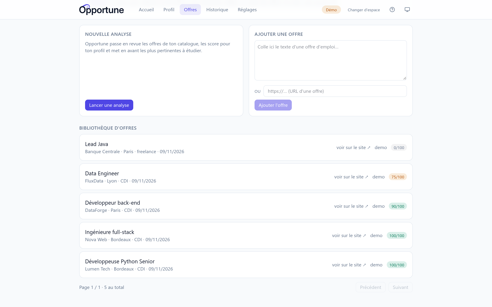
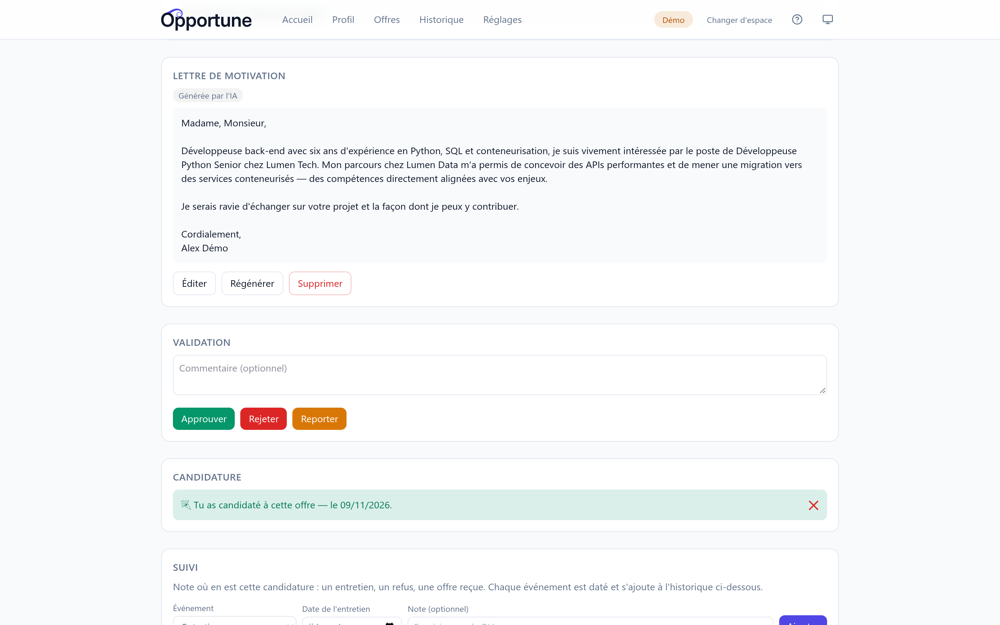

# Opportune

[](https://github.com/Karvaneg/Opportune/actions/workflows/ci.yml)
[](LICENSE)

<p align="center">
  
</p>

<p align="center">
  <a href="https://github.com/Karvaneg/Opportune/releases/latest">
    
  </a>
  <br />
  <sub>Windows (<code>.exe</code>, <code>.msi</code>) · Linux (<code>.deb</code>, <code>.rpm</code>, <code>.AppImage</code>) · <a href="#installation">Comment installer</a></sub>
</p>

> **Local-first job-application assistant** — collects job offers, scores them against your
> profile with a local LLM (Ollama), and drafts tailored cover letters. Everything runs on
> your machine, nothing leaves it, and every outbound action needs your explicit approval.

**Highlights**

- 🔒 **Local-first & private** — SQLite storage and a local LLM; no third-party data sharing.
- 🤖 **AI scoring & cover letters** — offer matching and letter drafting powered by Ollama.
- ✋ **Human-in-the-loop** — explicit human validation before any outbound action.
- 🧩 **Clean monorepo** — Python engine + HTTP API (`python/`), React/Vite dashboard (`frontend/`).
- ✅ **Tested & CI-checked** — pytest + Vitest run on every pull request.

> 📖 The documentation below is in French. If you don't read French, the Highlights above
> summarise the project; the architecture diagram and the per-module READMEs are the quickest
> way in.

---

## Installation

Opportune s'installe **par double-clic, sans terminal**, avec son assistant IA local embarqué.

1. Ouvre la page **[Télécharger Opportune](https://github.com/Karvaneg/Opportune/releases/latest)**
   (dernière version publiée) et, dans la partie **Assets**, prends le fichier de ton système :

   | Système                    | Fichier à télécharger                             |
   | -------------------------- | ------------------------------------------------- |
   | Windows                    | `.exe` (installeur classique) ou `.msi`           |
   | Linux (Debian, Ubuntu…)    | `.deb`                                            |
   | Linux (Fedora, openSUSE…)  | `.rpm`                                            |
   | Linux (toute distribution) | `.AppImage` (rendre exécutable, puis double-clic) |

2. Lance l'installeur. Les installeurs ne sont **pas encore signés** : Windows peut afficher
   « Windows a protégé votre ordinateur » ; clique sur **Informations complémentaires** puis
   **Exécuter quand même**.
3. Au premier lancement, Opportune propose de télécharger le modèle d'IA local (une seule
   fois). Tout reste ensuite sur ta machine.

Mac n'est pas encore disponible. Pour lancer Opportune depuis les sources, voir la partie
[Contribuer et développer](#contribuer-et-développer).

## Sommaire

**Utiliser Opportune**

- [Installation](#installation)
- [Premiers pas](#premiers-pas)
- [Sources d'offres](#sources-doffres)
- [Aperçu et design](#aperçu-et-design)
- [Feuille de route](#feuille-de-route)

**Contribuer et développer**

- [Prérequis](#prérequis)
- [Démarrage depuis les sources](#démarrage-depuis-les-sources)
- [Application de bureau](#application-de-bureau)
- [Cartographie du dépôt](#cartographie-du-dépôt)
- [Architecture](#architecture)
- [Tests](#tests)
- [Configuration](#configuration)
- [Documentation](#documentation)
- [Historique : du prototype Node.js à Opportune](#historique--du-prototype-nodejs-à-opportune)

[Autrice](#autrice)

## Premiers pas

1. Au lancement, choisis **Démo** pour découvrir Opportune avec des données d'exemple, ou
   **Mon espace** pour ta vraie recherche. Les deux espaces sont séparés.
2. Si le modèle d'IA n'est pas encore installé, un bandeau en haut de l'écran propose de le
   télécharger.
3. **Profil** : importe ton CV en PDF. Opportune en extrait tes compétences et ton parcours.
4. **Réglages** : renseigne tes sources d'offres (clés Adzuna, flux RSS, pages carrière des
   entreprises qui t'intéressent).
5. **Offres** : récupère de nouvelles offres. Tu peux aussi ajouter une offre à la main depuis
   l'**Accueil**.
6. **Accueil** : lance une analyse. Opportune score les offres pour ton profil, recommande les
   meilleures et rédige une lettre de motivation que tu relis et modifies.
7. Décide pour chaque recommandation, puis note la suite de tes candidatures (entretien, refus,
   offre reçue).

Rien n'est envoyé sans ta validation explicite.

## Sources d'offres

Opportune collecte des offres réelles via des **connecteurs**, tous configurés dans la page
**Réglages** :

- **Adzuna** : source principale. L'inscription est gratuite et la clé est délivrée tout de
  suite sur [developer.adzuna.com](https://developer.adzuna.com) (quota gratuit d'environ
  2 500 appels par mois).
- **Flux RSS/Atom** : sans identifiant, à alimenter avec tes propres flux d'alertes emploi.
- **Entreprises ciblées** : sans identifiant. Tu colles la page carrière des entreprises qui
  t'intéressent, si elles publient via Greenhouse ou Lever, et Opportune lit leurs offres en
  France directement à la source.
- **France Travail** : l'API officielle, la plus riche, est **indisponible aujourd'hui**
  (vérifié en octobre 2026). Elle a été retirée de `francetravail.io` le temps d'une analyse de
  ses conditions de réutilisation, après des usages automatisés massifs par des solutions d'IA.
  À sa réouverture, l'accès se fera sur autorisation préalable. Le connecteur existe mais reste
  **dormant**.

Détail des connecteurs : [`python/docs/collecte-offres.md`](python/docs/collecte-offres.md).

## Aperçu et design

Opportune se veut un **copilote de confiance** : sérieux et rigoureux, mais chaleureux, pas un
outil corporate. Sa signature reprend le mythe du **toupet de Kairos** (le dieu grec du moment
opportun, qu'on attrape au passage par son unique mèche de cheveux) : dans le logo, le trait du
**O** se décolle et s'enroule au-dessus des « pp », en indigo. L'occasion passe, Opportune aide à
la saisir.

Interface **React/Vite**, **thèmes clair et sombre** (bascule auto / clair / sombre), couleurs
pilotées par des **jetons sémantiques**. Design system complet :
[`frontend/src/styles/README.md`](frontend/src/styles/README.md).

| Jeton     | Rôle                                     | Clair     | Sombre    |
| --------- | ---------------------------------------- | --------- | --------- |
| `brand`   | marque — mèche, liens, action principale | `#4f46e5` | `#818cf8` |
| `ink`     | texte                                    | `#0f172a` | `#f8fafc` |
| `surface` | fond                                     | `#f8fafc` | `#0f172a` |
| `success` | succès                                   | `#059669` | `#34d399` |
| `warning` | alerte                                   | `#d97706` | `#fbbf24` |
| `danger`  | erreur                                   | `#dc2626` | `#f87171` |

### Captures d'écran

_Captures prises dans l'espace Démo (aucune donnée personnelle)._

|                       Écran d'accueil — Démo / Mon espace                       |                             Cockpit — guide de démarrage                              |
| :-----------------------------------------------------------------------------: | :-----------------------------------------------------------------------------------: |
|              |         |
|                             **Cockpit — synthèse**                              |                             **Profil — CV & compétences**                             |
|  |              |
|                               **Offres scorées**                                |                              **Recommandation + lettre**                              |
|                            |  |

## Feuille de route

**Livré dans la v1.0.0** : Opportune s'installe sans compétences techniques.

- 📦 **Application de bureau** (Tauri) pour Windows et Linux, avec le moteur Python et le
  dashboard embarqués.
- 🧠 **IA locale clé en main** : Ollama est embarqué et le modèle se télécharge depuis
  l'interface au premier lancement.
- ⚙️ **Configuration dans l'app** : clés Adzuna, flux RSS et entreprises ciblées se règlent dans
  la page Réglages ; l'espace Démo est utilisable tout de suite.
- 📋 **Suivi des candidatures** : entretien, refus, offre reçue.

**Prochaines étapes**

- **Signer** les installeurs Windows, pour supprimer l'avertissement au lancement.
- Installeur **Mac** signé et notarisé.
- Ajouter **SmartRecruiters** aux entreprises ciblées, une fois ses conditions d'utilisation
  vérifiées.
- Plus tard : remplacer Ollama par un moteur **llama.cpp** embarqué, et proposer un **LLM
  cloud optionnel** pour les machines modestes.

---

# Contribuer et développer

## Prérequis

- **Python ≥ 3.11** (back) et **Node.js ≥ 18** (front).
- **Docker** (facultatif) : un environnement conteneurisé existe toujours, mais ce n'est plus
  la voie utilisée par défaut.

## Démarrage depuis les sources

### Back — API Python

Opportune est **local et mono-utilisateur** : l'API démarre **sans jeton** et n'écoute que sur
`localhost`.

**Démarrage simplifié (recommandé)**, depuis la racine du dépôt :

```bash
bash scripts/serve-api.sh                      # écoute sur http://127.0.0.1:8000
```

Le script lit toute la configuration depuis `python/.env`, **auto-détecte `OLLAMA_HOST`** sous
WSL et utilise le venv s'il existe (modèle : [`python/.env.example`](python/.env.example)). La
première **recherche** se crée ensuite directement **depuis l'app** (barre de recherche).
Détails : [`python/README.md`](python/README.md#lancer-lapi).

**Démarrage manuel**, depuis `python/` :

```bash
export OPPORTUNE_DB_PATH=data/opportune.db     # base SQLite (défaut : data/opportune.db)

python -m api.server                           # écoute sur http://127.0.0.1:8000
```

### Front — dashboard React

Depuis `frontend/` (l'API doit tourner en parallèle) :

```bash
npm install
npm run dev        # http://localhost:5173, proxy /api → http://localhost:8000
```

Cible du proxy surchargeable via `API_PROXY_TARGET`.

## Application de bureau

Pour construire l'app de bureau et ses installeurs (Linux depuis WSL ou Linux, Windows depuis
l'hôte Windows) : [`frontend/src-tauri/README.md`](frontend/src-tauri/README.md). L'app lance
l'API et un Ollama embarqué (version CPU), propose de télécharger le modèle au premier
lancement, et range bases SQLite et modèles dans un seul dossier de données propre à l'app.

## Cartographie du dépôt

```
python/         Back : métier, orchestrateur Hermes, API HTTP, persistance SQLite
  packaging/    Binaire autonome de l'API (PyInstaller), qui sert aussi le front compilé
frontend/       Front : dashboard React/Vite (offres scorées, lettres, décisions, suivi)
  src-tauri/    Coquille de l'app de bureau (Tauri) : lance l'API et Ollama, ouvre la fenêtre
docs/           Vision, definition of done, décisions d'architecture (ADR)
scripts/        Scripts utilitaires (serveur API, contexte IA)
legacy/         Prototype Node.js archivé (voir l'Historique plus bas)
```

Chaque brique a son propre README détaillé :

- **Back** → [`python/README.md`](python/README.md)
- **Front** → [`frontend/README.md`](frontend/README.md)
- **App de bureau** → [`frontend/src-tauri/README.md`](frontend/src-tauri/README.md)

## Architecture

```
                      App de bureau (Tauri)
  ┌──────────────────────────────────────────────────────────┐
  │  Fenêtre : front React compilé                           │
  │        │                                                 │
  │        │ HTTP, 127.0.0.1:8000                            │
  │        ▼                                                 │
  │  API Python (binaire) : métier + orchestrateur Hermes    │
  │        │                        │                        │
  │        ▼                        ▼                        │
  │  SQLite + réglages        Ollama (LLM local)             │
  └────────┬─────────────────────────────────────────────────┘
           │ lecture des offres publiées
           ▼
  Adzuna · flux RSS · Greenhouse · Lever
```

Dans l'app de bureau, le binaire API sert lui-même le front compilé ; la coquille Tauri lance
ce binaire et Ollama, puis ouvre une fenêtre dessus. En développement, Vite sert le front et
relaie `/api` vers l'API.

- L'API expose la consultation (profil, recherches, catalogue d'offres scoré, analyses et
  recommandations) et les actions : collecte, décision, lettre de motivation, suivi de
  candidature, réglages et installation du modèle. Les actions sensibles exigent une
  confirmation explicite.
- Auth : **aucune**. Opportune est local et mono-utilisateur : l'API n'écoute que sur
  `localhost` et le front identifie l'unique utilisateur local par un simple `GET /me`.
  Historique de cette décision :
  [`docs/adr/0003-auth-local-first-sans-jeton.md`](docs/adr/0003-auth-local-first-sans-jeton.md).

## Tests

- **Back** : `cd python && .venv/bin/pytest -q`
- **Front** : `cd frontend && npm test`

Les deux suites tournent à chaque pull request (GitHub Actions). Détails et variantes (lint,
build, Docker en option) dans les READMEs respectifs.

## Configuration

Dans l'app, toute la configuration utile (clés Adzuna, flux RSS, entreprises ciblées,
installation du modèle) se fait depuis l'interface, sans fichier à éditer. Pour le
développement, la config du back se trouve dans `python/.env` (modèle :
[`python/.env.example`](python/.env.example)), lu par `scripts/serve-api.sh`. Ce fichier est
gitignoré et ne doit jamais être commité.

## Documentation

- [`docs/vision.md`](docs/vision.md) — vision produit
- [`docs/definition-of-done.md`](docs/definition-of-done.md) — definition of done
- [`docs/adr/`](docs/adr/) — décisions d'architecture (ADR)
- [`frontend/src-tauri/README.md`](frontend/src-tauri/README.md) — app de bureau et installeurs
- [`python/docs/`](python/docs/) — collecte d'offres, revue Discord (historique)

## Historique : du prototype Node.js à Opportune

Opportune a d'abord été un **prototype en ligne de commande, en Node.js** (intégration Notion,
stockage JSON). Il a permis de **valider vite** la boucle produit. Python porte mieux le cœur
réel d'Opportune (LLM local, extraction de CV, scoring) et a permis le **packaging desktop** :
la logique métier a donc migré vers `python/`. Détail :
[`docs/adr/0004-pivot-node-python.md`](docs/adr/0004-pivot-node-python.md).

Le prototype est archivé sous [`legacy/`](legacy/) comme référence et reste exécutable depuis
son dossier :

```bash
cd legacy
npm install
cp .env.example .env.local   # renseigner NOTION_TOKEN, NOTION_DATABASE_ID, NOTION_DATA_SOURCE_ID…
npm start                    # affiche le prochain ticket recommandé
npm test                     # suite du prototype via node --test
```

Détails dans [`legacy/README.md`](legacy/README.md). Les données locales du prototype sont
stockées en JSON sous `data/` (gitignoré) et ne quittent pas ta machine.

## Autrice

Opportune est conçu et développé par **Marie Le Carvennec** [@karvaneg](https://github.com/Karvaneg).<br />
🌐 [Portfolio Karvaneg](https://portfolio-karvaneg.vercel.app) ·
[LinkedIn](https://linkedin.com/in/marielecarvennec) ·
[Playbook IA](https://portfolio-karvaneg.vercel.app/playbook)
