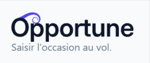
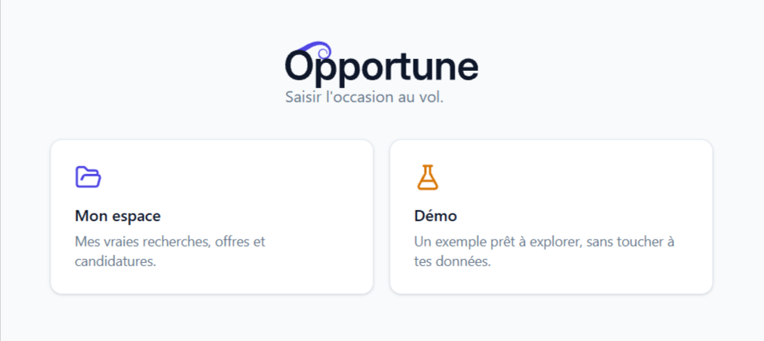
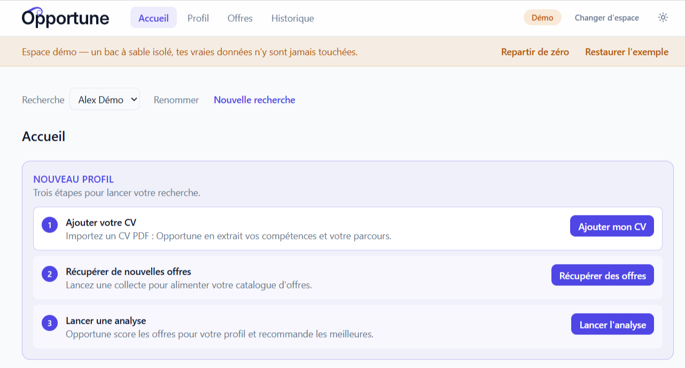
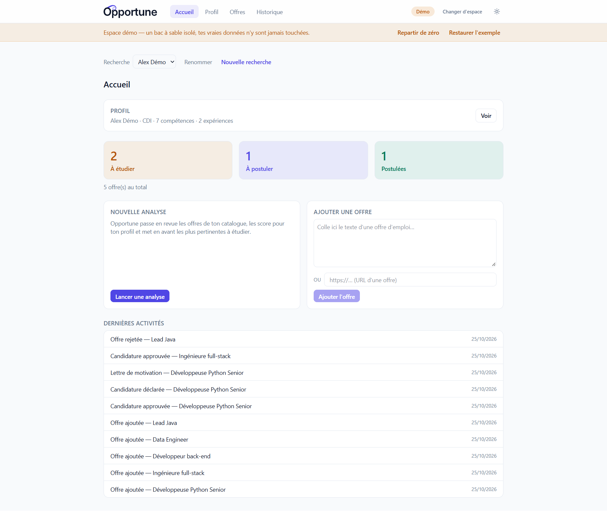
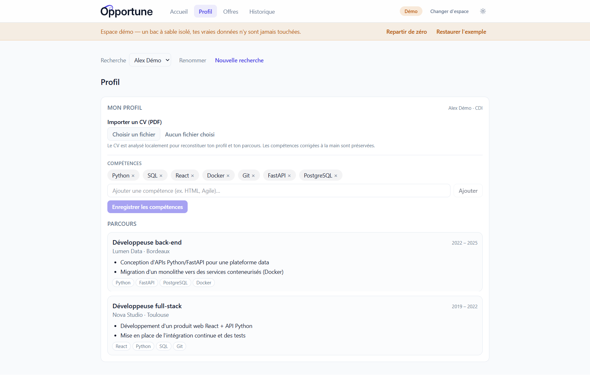
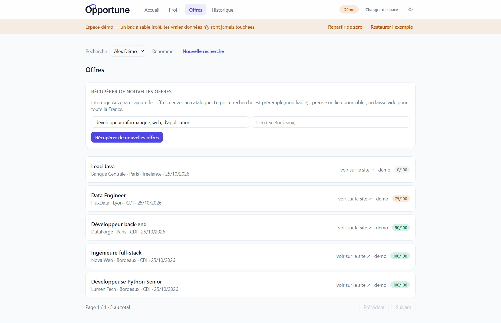
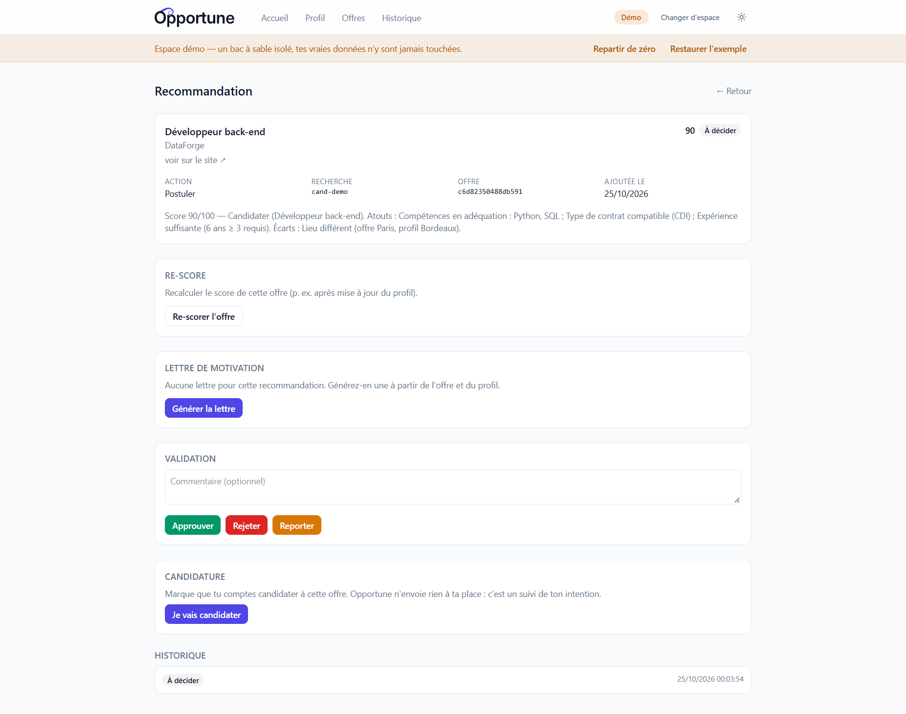

# Opportune

[](https://github.com/Karvaneg/Opportune/actions/workflows/ci.yml)
[](LICENSE)

<p align="center">
  
</p>

> **Local-first job-application assistant** — collects job offers, scores them against your
> profile with a local LLM (Ollama), and drafts tailored cover letters. Everything runs on
> your machine, nothing leaves it, and every outbound action needs your explicit approval.

**Highlights**

- 🔒 **Local-first & private** — SQLite storage and a local LLM; no third-party data sharing.
- 🤖 **AI scoring & cover letters** — offer matching and letter drafting powered by Ollama.
- ✋ **Human-in-the-loop** — explicit human validation before any outbound action.
- 🧩 **Clean monorepo** — Python engine + HTTP API (`python/`), React/Vite dashboard (`frontend/`).
- ✅ **Tested & CI-checked** — pytest + Vitest run on every pull request.

> 📖 The documentation below is in French. If you don't read French, the Highlights above
> summarise the project; the architecture diagram and the per-module READMEs are the quickest
> way in.

---

> 🚧 **Bientôt : une application à installer en un clic.** Aujourd'hui, mettre en place
> Opportune demande un environnement technique (Python, Node ou Docker, plus Ollama) —
> c'est réservé à un public à l'aise avec ces outils. Une **application de bureau
> Windows/Mac**, installable par **double-clic et sans terminal** (LLM embarqué), est en
> préparation : c'est le palier **Opportune 1.0**. Voir la [feuille de route](#feuille-de-route).

## Sommaire

- [Migration V1 → V2](#migration-v1--v2)
- [Cartographie du dépôt](#cartographie-du-dépôt-monorepo)
- [Architecture V2](#architecture-v2-vue-densemble)
- [Aperçu et design](#aperçu-et-design)
- [Prérequis](#prérequis)
- [Démarrage (V2)](#démarrage-v2)
- [Sources d'offres](#sources-doffres--pourquoi-adzuna-par-défaut)
- [Tests](#tests)
- [Configuration](#configuration)
- [Feuille de route](#feuille-de-route)
- [Documentation](#documentation)
- [Legacy V1 (Node.js)](#legacy-v1-nodejs)

## Migration V1 → V2

Le projet est en **migration V1 → V2** :

- **V2 (Python) — active.** Le moteur métier, l'orchestrateur **Hermes**, l'API HTTP et
  un **frontend web de consultation** (React/Vite). C'est là que se fait le développement
  courant. Code sous `python/` et `frontend/`.
- **V1 (Node.js) — historique.** Le MVP CLI d'origine (intégration Notion, stockage JSON)
  vit encore à la racine (`src/`, `package.json`). Conservé comme référence le temps de la
  migration ; il n'est plus la cible produit.

## Cartographie du dépôt (monorepo)

```
python/         Back V2 : métier, orchestrateur Hermes, API HTTP, persistance SQLite
frontend/       Front V2 : dashboard React/Vite (runs, offres scorées, lettres, décisions)
docs/           Vision, definition of done, décisions d'architecture (ADR)
scripts/        Scripts utilitaires (serveur API, contexte IA)
src/            V1 Node.js (historique — voir « Legacy V1 » plus bas)
```

Chaque brique V2 a son propre README détaillé :

- **Back** → [`python/README.md`](python/README.md)
- **Front** → [`frontend/README.md`](frontend/README.md)

## Architecture V2 (vue d'ensemble)

```
  ┌────────────┐   HTTP  /api   ┌──────────────┐        ┌───────────────┐
  │  frontend/ │ ─────────────▶ │  API Python  │ ─────▶ │ Hermes +      │
  │ React/Vite │  même machine  │ (python/api) │        │ métier + LLM  │
  └────────────┘                └──────────────┘        └───────┬───────┘
                                        │                        │
                                        ▼                        ▼
                                  GET /me, /runs            SQLite (run_store)
```

- L'API expose la consultation (`GET /me`, `GET /runs`, détail, recommandations paginées,
  catalogue d'offres scoré `GET /offers`) et les actions (décision, lettre de motivation,
  `/confirm`) — ces dernières exigent le rôle `reviewer` et une confirmation explicite.
- Le frontend consomme l'API via un proxy `/api` (cf. [`frontend/README.md`](frontend/README.md)) :
  consultation (runs, recommandations, catalogue d'offres) **et** actions validées —
  décision humaine, génération/édition/suppression de lettre, ajout d'offre.
- Auth : **aucune** — local-first et mono-utilisateur (OPP-181). L'API n'écoute que sur
  `localhost` et démarre sans jeton ; au lancement, le frontend fait un simple `GET /me` pour
  identifier l'unique utilisateur local (plus de login ni de jeton porteur). Historique de cette
  décision : [`docs/adr/0003-auth-local-first-sans-jeton.md`](docs/adr/0003-auth-local-first-sans-jeton.md)
  (remplace l'ADR 0002).

## Aperçu et design

Opportune se veut un **copilote de confiance** : sérieux et rigoureux, mais chaleureux — pas un
outil corporate. Sa signature reprend le mythe du **toupet de Kairos** (le dieu grec du moment
opportun, qu'on attrape au passage par son unique mèche de cheveux) : dans le logo, le trait du
**O** se décolle et s'enroule au-dessus des « pp », en indigo. L'occasion passe, Opportune aide à
la saisir.

Interface **React/Vite**, **thèmes clair et sombre** (bascule auto / clair / sombre), couleurs
pilotées par des **jetons sémantiques**. Design system complet :
[`frontend/src/styles/README.md`](frontend/src/styles/README.md).

| Jeton | Rôle | Clair | Sombre |
|---|---|---|---|
| `brand` | marque — mèche, liens, action principale | `#4f46e5` | `#818cf8` |
| `ink` | texte | `#0f172a` | `#f8fafc` |
| `surface` | fond | `#f8fafc` | `#0f172a` |
| `success` | succès | `#059669` | `#34d399` |
| `warning` | alerte | `#d97706` | `#fbbf24` |
| `danger` | erreur | `#dc2626` | `#f87171` |

### Captures d'écran

*Captures prises dans l'espace Démo (aucune donnée personnelle).*

| Écran d'accueil — Démo / Mon espace | Cockpit — guide de démarrage |
|:---:|:---:|
|  |  |
| **Cockpit — synthèse** | **Profil — CV & compétences** |
|  |  |
| **Offres scorées** | **Recommandation + lettre** |
|  |  |

## Prérequis

- **Python ≥ 3.11** (back) et **Node.js ≥ 18** (front), ou **Docker** (chemin recommandé,
  reproductible — notamment sous WSL2).

## Démarrage (V2)

### Back — API Python

Opportune est **local et mono-utilisateur** : l'API démarre **sans jeton** (local-first,
OPP-181) et n'écoute que sur `localhost`.

**Démarrage simplifié (recommandé, OPP-153)** — depuis la racine du dépôt :

```bash
bash scripts/serve-api.sh                      # écoute sur http://127.0.0.1:8000
```

Le script lit toute la configuration depuis `python/.env` (**source unique** — plus de
variables à retaper), **auto-détecte `OLLAMA_HOST`** sous WSL et utilise le venv s'il existe.
Renseigner au minimum `OPPORTUNE_API_CANDIDATES` dans `python/.env`
(modèle : [`python/.env.example`](python/.env.example)). Détails :
[`python/README.md`](python/README.md#lancer-lapi).

**Démarrage manuel** (variables à l'ancienne) — depuis `python/` :

```bash
export OPPORTUNE_API_CANDIDATES=ma-recherche  # périmètre : recherches amorcées (CSV)
export OPPORTUNE_DB_PATH=data/opportune.db     # base SQLite (défaut : data/opportune.db)

python -m api.server                           # écoute sur http://127.0.0.1:8000
```

### Front — dashboard React

Depuis `frontend/` (l'API doit tourner en parallèle) :

```bash
npm install
npm run dev        # http://localhost:5173, proxy /api → http://localhost:8000
```

Cible du proxy surchargeable via `API_PROXY_TARGET` (ex. réseau Docker).

### Démo Docker de bout en bout

Front et API sur un réseau bridge partagé, ports publiés vers l'hôte (host-networking
inopérant sous Docker Desktop/WSL2).

## Sources d'offres — pourquoi Adzuna par défaut

Opportune collecte des offres réelles via des **connecteurs** (détail et commandes :
[`python/README.md`](python/README.md#collecter-des-offres-réelles-opp-120--opp-122)) :

- **Adzuna** — source **recommandée et par défaut** : inscription gratuite et **clé délivrée
  instantanément en self-service**, idéale pour que n'importe qui installe Opportune et collecte
  tout de suite (quota gratuit ~2 500 appels/mois).
- **RSS/Atom** — sans identifiant, à alimenter avec vos propres flux d'alertes emploi.
- **France Travail** — l'API officielle, la plus riche, mais **indisponible aujourd'hui**
  (vérifié oct. 2026) : elle a été **retirée de `francetravail.io`** le temps d'une analyse des
  modalités de distribution/réutilisation, suite à des **usages automatisés massifs par des
  solutions d'IA**. À sa réouverture, l'accès sera **sur autorisation préalable** (pas de
  self-service), ce qui se prête mal à une diffusion large. Le connecteur existe mais reste
  **dormant** — d'où le choix d'Adzuna comme source par défaut.

## Tests

- **Back** : `cd python && docker compose run --rm app pytest -q`
- **Front** : `cd frontend && docker run --rm -v "$PWD":/app -v /app/node_modules opportune-frontend:dev npm test`

Détails et variantes (venv local, lint, build) dans les READMEs respectifs.

## Configuration

Les variables sensibles se placent dans un `.env.local` (gitignoré, jamais commité).
Voir `.env.example` et les READMEs de chaque brique pour la liste complète.

## Feuille de route

**Opportune 1.0 — installation grand public.** La prochaine étape vise à rendre Opportune
installable par **n'importe quelle personne en recherche d'emploi**, sans compétences
techniques :

- 📦 **Application de bureau** (Windows/Mac) packagée avec **Tauri** : un **installeur à
  double-clic**, aucune ligne de commande. Le moteur Python et le dashboard web sont embarqués
  dans l'application.
- 🧠 **LLM clé en main** : l'application installe et pilote **Ollama** et télécharge le modèle
  au premier lancement — plus rien à configurer à la main, et le **tout-local** est préservé.
- ⚙️ **Configuration dans l'app** : un écran de bienvenue remplace l'édition de fichiers
  `.env` ; l'app est utilisable immédiatement (espace démo + RSS), la clé Adzuna devient
  optionnelle.

En attendant, l'installation décrite plus haut (environnement Python/Node ou Docker) reste la
voie pour les profils techniques et les contributeurs.

## Documentation

- [`docs/vision.md`](docs/vision.md) — vision produit
- [`docs/definition-of-done.md`](docs/definition-of-done.md) — definition of done
- [`docs/adr/`](docs/adr/) — décisions d'architecture (ADR)

## Legacy V1 (Node.js)

Le MVP CLI d'origine reste exécutable depuis la racine (récupère les tickets Notion et
suggère le prochain à traiter). Il n'est plus la cible produit ; la logique métier migre
vers `python/`.

```bash
npm install
cp .env.example .env.local   # renseigner NOTION_TOKEN, NOTION_DATABASE_ID, NOTION_DATA_SOURCE_ID…
npm start                    # affiche le prochain ticket recommandé
npm test                     # suite V1 via node --test
```

Les données locales V1 sont stockées en JSON sous `data/` (gitignoré) et ne quittent pas
votre machine.
